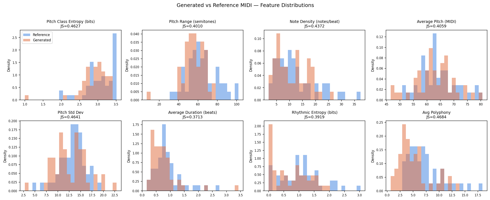

# Transformer-based Symbolic Music Generation

An independent undergraduate research project exploring musical token representations with an approximately 40M-parameter PyTorch Transformer trained from scratch on a corpus of 422 Touhou MIDI arrangements.

[Project portfolio (PDF)](docs/Touhou_Music_Generation_Portfolio.pdf) | [Results and MIDI examples](docs/README.md)

## Experiments

- **Baseline:** standard REMI bar-boundary markers.
- **BARPOS:** cyclic position markers replacing Bar_None.
- **HarmRole:** harmonic-role labels following pitch events, estimated using music21.
- **HarmRole v2:** the residual non category split into scale and chromatic labels.

BARPOS improved some measured distributions, with mixed results across metrics. In HarmRole v1, 73.8% of labels were non. Version 2 split this into 36.4% scale and 37.4% chromatic, without consistent improvement in generated musical statistics. Different token vocabularies limit interpretation of raw validation-loss comparisons.

## Experimental evidence



Each variant generated 50 samples. Original per-file metrics and plots for all four variants are in docs/results/. Fixed seeds 0 and 1 from each variant are in docs/samples/; they are illustrative examples rather than a quality-ranked selection.

The evaluator uses SciPy Jensen-Shannon distance, despite legacy divergence labels in its output. These features measure statistical similarity, not overall musical quality or long-range structure.

## Running the project

Dependencies include PyTorch, MidiTok, miditoolkit, symusic, music21, NumPy, SciPy, matplotlib and tqdm. These names do not constitute a version-pinned environment; check compatibility with the installed MidiTok version. A CUDA GPU is recommended for training.

Run scripts from the repository root. Source MIDI files, token datasets and checkpoints must be prepared locally. Inspect path constants before running. Augmentation is implemented in src/augment_transpose.py.

```bash
# BARPOS
python src/tokenize_touhou_remi.py
python -u src/train_touhou_from_scratch.py

# Baseline
python src/tokenize_touhou_baseline.py
python -u src/train_touhou_baseline.py

# HarmRole variants
python src/tokenize_touhou_harmrole.py
python -u src/train_touhou_harmrole.py
python src/tokenize_touhou_harmrole_v2.py
python -u src/train_touhou_harmrole_v2.py

# Generate after training (also accepts baseline, harmrole, harmrole_v2)
python -u src/gen_batch.py barpos 0 50

# Evaluate
python src/evaluate_music.py --generated generated_midis/ --reference data/touhou_midi_collection/ --n_ref 50 --out eval_results/barpos/
```

## Limitations

The eight metrics do not directly evaluate melodic contour, motif development, phrase organisation or perceptual coherence. The limited corpus, absence of repeated training runs and lack of a formal listening study restrict the findings. HarmRole also changes vocabulary size and sequence length. Informal sample inspection found repetitive rhythms and unstable continuation.

Historical scripts and archived outputs are retained. [Early preprocessing notes](docs/early_preprocessing_notes.md) describe earlier experiments rather than the settings of every current model. Source compositions and arrangements belong to their respective creators; the source corpus and prompt continuations are not included in this update.
